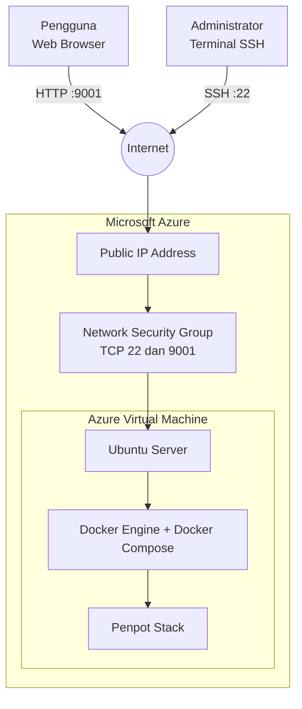
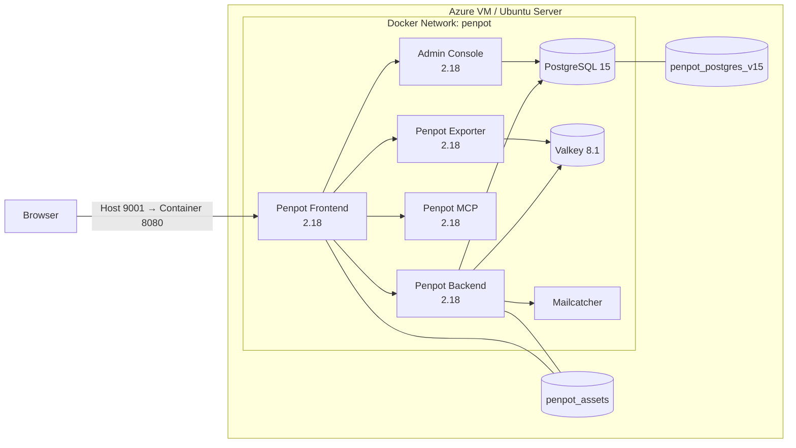
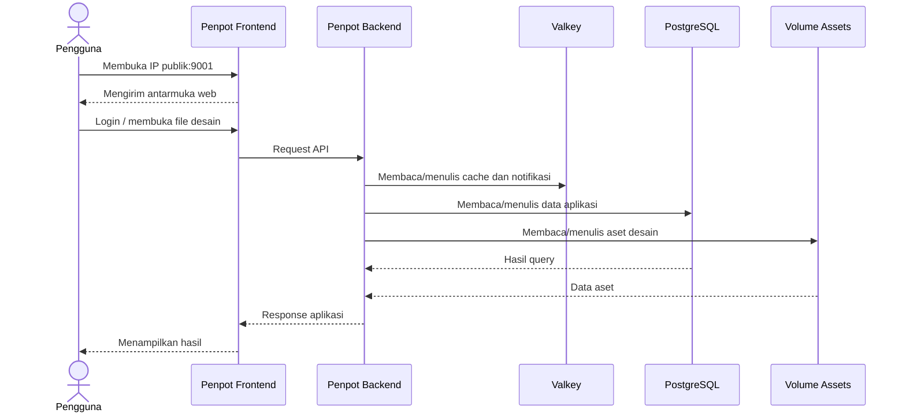
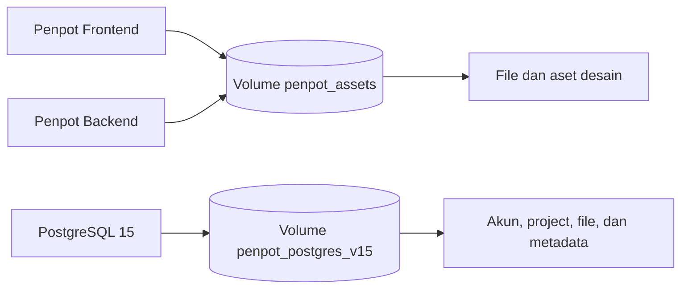
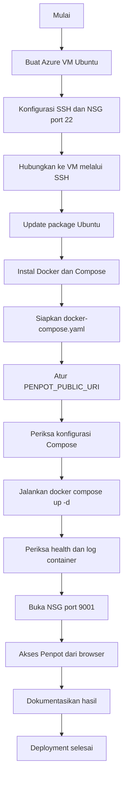

# Laporan Proyek Self-Hosting Penpot

## 1. Informasi Proyek

| Keterangan | Detail |
|---|---|
| Aplikasi | Penpot |
| Kategori | Collaborative Design / UI Design & Prototyping |
| Repository aplikasi | https://github.com/penpot/penpot |
| Metode implementasi | Self-hosting dengan Docker Compose |
| Infrastruktur final | Microsoft Azure Virtual Machine |
| Sistem operasi server | Ubuntu Server |
| Akses aplikasi saat ini | IP publik VM melalui HTTP port `9001` |
| Aplikasi pembanding | Figma |

## 2. Ringkasan Proyek

Proyek ini bertujuan mempelajari proses instalasi, konfigurasi, dan deployment aplikasi web secara mandiri. Aplikasi yang dipilih adalah **Penpot**, sebuah platform desain UI/UX dan prototyping berbasis web yang bersifat open-source dan mendukung self-hosting.

Penpot dijalankan menggunakan Docker Compose agar frontend, backend, database, cache, dan layanan pendukung dapat dikelola dalam satu konfigurasi. Setelah tahap persiapan dan penyusunan panduan instalasi lokal, implementasi final dilakukan pada Virtual Machine di Microsoft Azure.

Pada tahap laporan ini, deployment telah berhasil dilakukan. Container Penpot dapat berjalan pada Azure VM dan halaman aplikasi dapat diakses melalui alamat IP publik server. Bukti implementasi berupa screenshot Azure Portal, koneksi SSH, versi Docker, status container, halaman Penpot, dan file desain awal telah didokumentasikan.

Pekerjaan selanjutnya difokuskan pada penggunaan fitur utama, pengujian aplikasi secara terstruktur, serta perbandingan Penpot dengan Figma.

## 3. Pemilihan Aplikasi

Penpot dipilih karena memenuhi kebutuhan proyek self-hosting aplikasi web dan memiliki fungsi yang relevan untuk desain UI/UX.

Alasan pemilihan Penpot:

1. Bersifat open-source dan dapat dijalankan pada infrastruktur sendiri.
2. Menyediakan fitur desain antarmuka, prototyping, komponen, dan kolaborasi.
3. Memiliki arsitektur berbasis layanan yang sesuai untuk mempelajari Docker.
4. Dapat diakses melalui browser sehingga cocok untuk deployment pada server.
5. Memiliki aplikasi pembanding yang relevan dan populer, yaitu Figma.

## 4. Ruang Lingkup Implementasi

Ruang lingkup yang telah dikerjakan meliputi:

- Analisis awal aplikasi dan kebutuhan deployment.
- Penyediaan konfigurasi Docker Compose.
- Penyusunan panduan instalasi Penpot pada komputer lokal.
- Penyusunan panduan deployment umum dan Microsoft Azure.
- Pembuatan Azure Virtual Machine berbasis Ubuntu Server.
- Instalasi Docker Engine dan Docker Compose pada VM.
- Konfigurasi URL publik dan port aplikasi.
- Menjalankan seluruh layanan Penpot menggunakan Docker Compose.
- Konfigurasi akses jaringan melalui Azure Network Security Group.
- Verifikasi status container dan akses Penpot melalui browser.
- Dokumentasi tahapan deployment dan bukti screenshot.

Ruang lingkup yang belum selesai:

- Dokumentasi penggunaan fitur utama Penpot.
- Pengujian fungsional aplikasi secara terstruktur.
- Analisis dan perbandingan Penpot dengan Figma.

### 4.1 Rencana Deployment Awal

Pada awal proyek, implementasi direncanakan melalui dua tahap. Penpot terlebih dahulu disiapkan pada lingkungan lokal untuk mempelajari konfigurasi Docker, kemudian dipindahkan ke server agar dapat diakses melalui internet.

```text
Development / Testing
        │
        ▼
┌─────────────────────────┐
│      Local Machine      │
│                         │
│       VM / WSL          │
│        Ubuntu           │
│        Docker           │
│        Penpot           │
└────────────┬────────────┘
             │
             │ Konfigurasi dan validasi awal
             ▼
┌─────────────────────────┐
│      Cloud / VPS        │
│                         │
│      Ubuntu Server      │
│         Docker          │
│         Penpot          │
└────────────┬────────────┘
             │
             │ Akses jaringan
             ▼
          Internet
             │
             ▼
         End Users
```

Rencana tersebut direalisasikan menggunakan Microsoft Azure sebagai penyedia infrastruktur cloud. Implementasi akhir menggunakan Azure Virtual Machine, Ubuntu Server, dan Docker Compose.

### 4.2 Rencana Instalasi Lokal

Lingkungan lokal digunakan sebagai acuan untuk menjalankan Penpot tanpa hosting dan tanpa IP publik.

```text
┌──────────────────────────────────┐
│          Komputer Lokal          │
│                                  │
│  ┌────────────────────────────┐  │
│  │   Docker / Docker Desktop  │  │
│  │                            │  │
│  │  ┌──────────────────────┐  │  │
│  │  │    Penpot Stack      │  │  │
│  │  │                      │  │  │
│  │  │ Frontend + Backend   │  │  │
│  │  │ PostgreSQL + Valkey  │  │  │
│  │  └──────────┬───────────┘  │  │
│  └─────────────┼──────────────┘  │
│                │                 │
│                ▼                 │
│      http://localhost:9001       │
└──────────────────────────────────┘
```

Panduan untuk skenario ini tersedia pada [Installation Guide Lokal](../installation/installation-guide.md).

### 4.3 Realisasi Deployment Akhir

```text
┌───────────────────┐
│     End User      │
│    Web Browser    │
└─────────┬─────────┘
          │
          │ HTTP :9001
          ▼
┌───────────────────────────────┐
│       Microsoft Azure         │
│                               │
│  Public IP                    │
│      │                        │
│      ▼                        │
│  Network Security Group       │
│  ├── TCP 22   (SSH)           │
│  └── TCP 9001 (Penpot)        │
│      │                        │
│      ▼                        │
│  ┌─────────────────────────┐  │
│  │  Azure Virtual Machine  │  │
│  │  Ubuntu Server          │  │
│  │                         │  │
│  │  Docker Compose         │  │
│  │  ├── Frontend           │  │
│  │  ├── Backend            │  │
│  │  ├── PostgreSQL         │  │
│  │  ├── Valkey             │  │
│  │  └── Supporting Service │  │
│  └─────────────────────────┘  │
└───────────────────────────────┘
```

### 4.4 Perbandingan Rencana dan Realisasi

| Tahap | Rencana awal | Realisasi |
|---|---|---|
| Persiapan | VM/WSL dan Docker pada komputer lokal | Konfigurasi lokal dan panduan instalasi telah disiapkan |
| Server | VPS atau cloud hosting | Microsoft Azure Virtual Machine |
| Sistem operasi | Ubuntu | Ubuntu Server |
| Orkestrasi | Docker Compose | Docker Compose project `penpot` |
| Akses | Domain atau IP publik | IP publik Azure VM port `9001` |
| HTTPS | Direncanakan untuk penggunaan produksi | Belum diterapkan pada implementasi saat ini |
| Hasil | Penpot dapat diakses melalui internet | Berhasil diakses melalui browser |

## 5. Arsitektur Deployment

### 5.1 Topologi Infrastruktur

Deployment menggunakan satu Azure Virtual Machine sebagai host seluruh container. Pengguna mengakses aplikasi melalui IP publik VM, sedangkan administrator mengelola server melalui SSH.



Alur akses eksternal:

1. Browser mengirim request ke `http://<IP_PUBLIK_VM>:9001`.
2. Public IP meneruskan traffic menuju VM.
3. Network Security Group memeriksa inbound rule.
4. Docker meneruskan port host `9001` ke port `8080` milik container frontend.
5. Frontend berkomunikasi dengan layanan internal melalui network Docker bernama `penpot`.

### 5.2 Arsitektur Layanan Docker



Seluruh service berada pada jaringan internal yang sama. PostgreSQL dan Valkey tidak dipublikasikan ke internet. Dependensi kesehatan pada Compose memastikan backend menunggu PostgreSQL dan Valkey siap sebelum mulai bekerja.

### 5.3 Fungsi Setiap Komponen

| Komponen | Image/versi pada Compose | Fungsi | Akses |
|---|---|---|---|
| Penpot Frontend | `penpotapp/frontend:2.18` | Menyajikan antarmuka web dan menjadi pintu masuk pengguna | Host `9001` → container `8080` |
| Penpot Backend | `penpotapp/backend:2.18` | Menangani autentikasi, logika aplikasi, file, dan komunikasi data | Internal Docker |
| Penpot Admin Console | `penpotapp/admin-console:2.18` | Mendukung fungsi administrasi Penpot | Internal Docker |
| Penpot MCP | `penpotapp/mcp:2.18` | Menyediakan layanan integrasi Model Context Protocol | Internal Docker |
| Penpot Exporter | `penpotapp/exporter:2.18` | Memproses kebutuhan ekspor desain | Internal Docker |
| PostgreSQL | `postgres:15` | Menyimpan akun, project, file, dan metadata aplikasi | Internal Docker |
| Valkey | `valkey/valkey:8.1` | Cache serta koordinasi notifikasi dan WebSocket | Internal Docker |
| Mailcatcher | `sj26/mailcatcher:latest` | SMTP sementara untuk menangkap email pada tahap pengujian | SMTP internal `1025`; UI host `1080` |

Versi Penpot `2.18` merupakan nilai default pada file Compose dan dapat dioverride melalui variabel `PENPOT_VERSION`.

### 5.4 Alur Request dan Data



Diagram ini menunjukkan bahwa browser tidak berkomunikasi langsung dengan database. Semua operasi data diproses melalui backend, sedangkan akses pengguna masuk melalui frontend.

### 5.5 Arsitektur Persistensi



Named volume memisahkan data persisten dari lifecycle container. Container dapat dihentikan atau dibuat ulang tanpa otomatis menghapus database dan aset. Perintah `down -v` tetap harus dihindari jika data masih diperlukan karena opsi tersebut menghapus volume.

### 5.6 Batas Jaringan

| Jalur | Port | Status implementasi | Keterangan |
|---|---:|---|---|
| Administrator → Azure VM | `22/TCP` | Dibuka melalui NSG | Digunakan untuk SSH |
| Pengguna → Penpot Frontend | `9001/TCP` | Dibuka melalui NSG | Akses aplikasi melalui HTTP |
| Pengguna → PostgreSQL | `5432/TCP` | Tidak dibuka | Hanya digunakan pada network Docker |
| Pengguna → Valkey | `6379/TCP` | Tidak dibuka | Hanya digunakan pada network Docker |
| Host → Mailcatcher UI | `1080/TCP` | Dipetakan oleh Compose, tidak diperlukan untuk pengguna | NSG sebaiknya tetap menutup port ini |
| Pengguna → HTTPS | `443/TCP` | Belum diterapkan | Memerlukan domain dan reverse proxy |

Untuk instalasi lokal, `PENPOT_PUBLIC_URI` menggunakan `http://localhost:9001`. Pada Azure, nilainya disesuaikan menjadi `http://<IP_PUBLIK_VM>:9001`.

## 6. Implementasi

### 6.1 Persiapan Konfigurasi

File [`docker-compose.yaml`](../deploy/docker-compose.yaml) digunakan untuk mendefinisikan seluruh layanan Penpot. Konfigurasi ini mencakup:

- Image container yang digunakan setiap layanan.
- Jaringan internal Docker.
- Port frontend `9001:8080`.
- Konfigurasi koneksi PostgreSQL dan Valkey.
- Volume persisten untuk database dan aset.
- Variabel lingkungan dan fitur Penpot.

Panduan instalasi lokal juga telah dibuat sebagai acuan menjalankan Penpot tanpa hosting. Panduan tersebut menggunakan alamat `http://localhost:9001` dan tidak memerlukan domain, IP publik, maupun konfigurasi cloud.

Parameter penting pada Compose:

| Parameter | Nilai implementasi | Fungsi |
|---|---|---|
| Project Compose | `penpot` | Memberikan prefix konsisten pada resource Docker |
| Versi default Penpot | `2.18` | Menentukan tag image frontend, backend, admin console, MCP, dan exporter |
| Public URI lokal | `http://localhost:9001` | URL akses ketika dijalankan pada komputer lokal |
| Public URI Azure | `http://<IP_PUBLIK_VM>:9001` | URL akses implementasi server |
| Port frontend | `9001:8080` | Memetakan port VM ke frontend Penpot |
| Penyimpanan aset | `penpot_assets` | Menyimpan file dan aset desain |
| Penyimpanan database | `penpot_postgres_v15` | Menyimpan data PostgreSQL |
| Network internal | `penpot` | Menghubungkan seluruh container |
| Restart policy | `always` | Menjalankan kembali container setelah berhenti/reboot |

### 6.2 Penyediaan Microsoft Azure Virtual Machine

Deployment final menggunakan Virtual Machine pada Microsoft Azure dengan Ubuntu Server. Tahapan yang dilakukan meliputi:

1. Membuat Azure Virtual Machine.
2. Menentukan ukuran VM dan penyimpanan.
3. Membuat akun administrator dan SSH key.
4. Mengaktifkan akses administrasi melalui port `22`.
5. Menyimpan alamat IP publik VM.
6. Menghubungkan terminal lokal ke VM menggunakan SSH.

Private key disimpan secara lokal dan tidak dimasukkan ke repository.

Resource Azure yang terlibat dalam implementasi:

| Resource | Peran |
|---|---|
| Virtual Machine | Menjalankan Ubuntu, Docker, dan Penpot |
| OS disk | Menyimpan sistem operasi serta data Docker host |
| Network interface | Menghubungkan VM dengan virtual network |
| Public IP address | Menyediakan alamat akses dari internet |
| Virtual network/subnet | Menjadi jaringan VM pada Azure |
| Network Security Group | Mengatur traffic masuk ke port SSH dan aplikasi |

Koneksi administrator ke server dilakukan menggunakan private key:

```bash
mkdir -p ~/.ssh
cp /path/to/<NAMA_FILE_KEY>.pem ~/.ssh/<NAMA_FILE_KEY>.pem
chmod 600 ~/.ssh/<NAMA_FILE_KEY>.pem
ssh -i ~/.ssh/<NAMA_FILE_KEY>.pem <USERNAME>@<IP_PUBLIK_VM>
```

Izin `600` membatasi pembacaan private key hanya kepada pemilik file.

### 6.3 Instalasi Docker

Pada Azure VM dilakukan pembaruan indeks paket, kemudian dipasang Docker Engine, Docker Compose v2, dan utilitas yang diperlukan. Layanan Docker diaktifkan agar berjalan otomatis bersama sistem.

Perintah implementasi:

```bash
sudo apt update
sudo apt install -y docker.io docker-compose-v2 curl
sudo systemctl enable --now docker
```

Instalasi diverifikasi menggunakan informasi versi Docker dan Docker Compose. Bukti verifikasi telah disertakan pada dokumentasi deployment Azure.

```bash
sudo docker --version
sudo docker compose version
sudo systemctl status docker
```

Output versi memastikan binary tersedia, sedangkan status service memastikan Docker daemon aktif.

### 6.4 Konfigurasi Penpot

Konfigurasi Docker Compose Penpot ditempatkan pada server. Nilai `PENPOT_PUBLIC_URI` disesuaikan agar mengarah ke alamat berikut:

```text
http://<IP_PUBLIK_VM>:9001
```

Konfigurasi PostgreSQL dan backend diperiksa agar menggunakan nama layanan, database, username, password, dan URI koneksi yang konsisten pada jaringan internal Docker.

Konfigurasi penting yang diperiksa:

| Konfigurasi | Nilai contoh pada Compose | Catatan |
|---|---|---|
| `PENPOT_PUBLIC_URI` | `http://<IP_PUBLIK_VM>:9001` | Harus sesuai alamat yang digunakan pengguna |
| `PENPOT_DATABASE_URI` | `postgresql://penpot-postgres/penpot` | Menggunakan nama service pada network Docker |
| `PENPOT_DATABASE_USERNAME` | `penpot` | Harus konsisten dengan PostgreSQL |
| `PENPOT_DATABASE_PASSWORD` | Tidak ditampilkan pada laporan | Harus konsisten dan tidak dipublikasikan |
| `PENPOT_REDIS_URI` | `redis://penpot-valkey/0` | Menghubungkan backend/exporter ke Valkey |
| `PENPOT_OBJECTS_STORAGE_BACKEND` | `fs` | Menggunakan penyimpanan file pada volume |
| `PENPOT_OBJECTS_STORAGE_FS_DIRECTORY` | `/opt/data/assets` | Lokasi aset di dalam container |

Sebelum menjalankan deployment, konfigurasi dapat diperiksa secara statis dengan:

```bash
sudo docker compose -p penpot -f docker-compose.yaml config
```

Perintah tersebut membantu menemukan kesalahan struktur YAML atau hasil interpolasi variabel tanpa langsung menjalankan container.

### 6.5 Menjalankan Layanan

Penpot dijalankan sebagai project Compose bernama `penpot`:

```bash
sudo docker compose -p penpot -f docker-compose.yaml up -d
```

Docker mengunduh image yang diperlukan, membuat network dan volume, lalu menjalankan layanan di latar belakang. Status layanan kemudian diperiksa menggunakan:

```bash
sudo docker compose -p penpot -f docker-compose.yaml ps
```

Hasil dokumentasi menunjukkan container utama berhasil berjalan.

Status dan log diperiksa menggunakan:

```bash
sudo docker compose -p penpot -f docker-compose.yaml ps
sudo docker compose -p penpot -f docker-compose.yaml logs --tail=100
sudo docker compose -p penpot -f docker-compose.yaml logs -f penpot-backend
```

PostgreSQL menggunakan health check `pg_isready`, sedangkan Valkey menggunakan `valkey-cli ping`. Backend baru dijalankan setelah kedua layanan tersebut berstatus sehat sesuai dependensi pada Compose.

### 6.6 Konfigurasi Jaringan Azure

Network Security Group pada Azure dikonfigurasi untuk mengizinkan:

| Port | Protokol | Fungsi |
|---|---|---|
| `22` | TCP | Administrasi server melalui SSH |
| `9001` | TCP | Akses web Penpot melalui HTTP |

Database dan layanan internal tidak diekspos langsung ke internet. Aplikasi saat ini diakses menggunakan IP publik dan port `9001`.

Domain, reverse proxy, dan HTTPS belum diterapkan pada implementasi saat ini. Ketiganya menjadi peningkatan keamanan jika aplikasi akan digunakan dalam jangka panjang atau untuk lingkungan produksi.

Urutan konfigurasi jaringan:

1. Membuka halaman VM pada Azure Portal.
2. Memilih pengaturan networking atau Network Security Group.
3. Memastikan inbound rule SSH `22/TCP` tersedia untuk administrasi.
4. Menambahkan inbound rule `9001/TCP` untuk akses Penpot.
5. Membatasi source IP jika akses publik penuh tidak diperlukan.
6. Tidak membuka port PostgreSQL, Valkey, atau layanan internal lain.
7. Menguji akses dari browser menggunakan jaringan di luar VM.

### 6.7 Persistensi Data

Docker named volume digunakan untuk menyimpan:

- Database PostgreSQL.
- Aset desain yang diunggah ke Penpot.

Dengan mekanisme ini, data tidak otomatis hilang ketika container dihentikan atau dibuat ulang. Penghapusan volume tetap harus dilakukan secara hati-hati karena dapat menghapus data secara permanen.

| Volume | Dipasang pada | Data yang disimpan |
|---|---|---|
| `penpot_assets` | Frontend dan backend | Aset, gambar, dan file yang dikelola Penpot |
| `penpot_postgres_v15` | PostgreSQL | Database akun, project, file, dan metadata |

Volume dapat diperiksa menggunakan:

```bash
sudo docker volume ls
sudo docker compose -p penpot -f docker-compose.yaml config --volumes
```

Backup perlu mencakup kedua volume. Menyalin direktori volume secara langsung ketika database aktif tidak disarankan; backup database dan volume harus dilakukan dengan prosedur yang konsisten.

### 6.8 Urutan Deployment



Diagram tersebut memperlihatkan ketergantungan antar tahap. Akses publik diuji setelah service berjalan dan aturan jaringan tersedia, sedangkan dokumentasi dilakukan setelah hasil deployment dapat diverifikasi.

### 6.9 Operasional dan Pemeliharaan

Perintah yang digunakan untuk mengelola lifecycle aplikasi:

| Aktivitas | Perintah |
|---|---|
| Melihat status | `sudo docker compose -p penpot -f docker-compose.yaml ps` |
| Melihat log | `sudo docker compose -p penpot -f docker-compose.yaml logs --tail=100` |
| Menghentikan sementara | `sudo docker compose -p penpot -f docker-compose.yaml stop` |
| Menjalankan kembali | `sudo docker compose -p penpot -f docker-compose.yaml start` |
| Mengunduh image | `sudo docker compose -p penpot -f docker-compose.yaml pull` |
| Menerapkan konfigurasi/image | `sudo docker compose -p penpot -f docker-compose.yaml up -d` |
| Menghapus container/network | `sudo docker compose -p penpot -f docker-compose.yaml down` |

Perintah `down` tidak menghapus named volume secara default. Perintah `down -v` tidak dicantumkan sebagai operasi rutin karena dapat menghapus seluruh data persisten.

Prosedur pembaruan yang aman:

1. Periksa versi dan catatan rilis Penpot.
2. Buat backup database dan aset.
3. Unduh image yang dibutuhkan.
4. Jalankan ulang stack menggunakan `up -d`.
5. Periksa status, health check, dan log.
6. Verifikasi akses melalui browser dan integritas data.

### 6.10 Keamanan dan Batasan Implementasi

Implementasi saat ini berhasil memenuhi kebutuhan deployment dan akses web, tetapi masih menggunakan HTTP langsung pada port `9001`. Kondisi ini sesuai untuk demonstrasi proyek, bukan konfigurasi produksi jangka panjang.

| Temuan | Kondisi saat ini | Rekomendasi lanjutan |
|---|---|---|
| Transport web | HTTP pada port `9001` | Gunakan domain, reverse proxy, dan HTTPS |
| Cookie | Secure cookie dinonaktifkan untuk HTTP | Aktifkan secure cookie setelah HTTPS tersedia |
| Secret key | Compose menyediakan placeholder | Ganti dengan secret acak yang kuat |
| Kredensial database | Nilai Compose perlu diamankan | Gunakan password unik dan jangan commit secret |
| SSH | Menggunakan private key | Batasi source IP port `22` dan nonaktifkan login yang tidak diperlukan |
| Mailcatcher | UI dipetakan ke host `1080` | Jangan membuka port `1080` melalui NSG; hapus mapping jika tidak dibutuhkan |
| Backup | Belum dijelaskan sebagai otomatis | Buat jadwal backup database dan aset |
| Monitoring | Menggunakan status dan log Docker | Tambahkan monitoring resource dan alert untuk penggunaan jangka panjang |

### 6.11 Troubleshooting Deployment

| Permasalahan | Pemeriksaan | Tindakan |
|---|---|---|
| SSH tidak dapat terhubung | Status VM, IP, username, key, dan NSG port `22` | Perbaiki parameter SSH atau inbound rule |
| Docker daemon tidak aktif | `sudo systemctl status docker` | Jalankan `sudo systemctl start docker` |
| Konfigurasi Compose invalid | `docker compose ... config` | Perbaiki YAML atau variabel environment |
| Container berhenti/restart | `docker compose ... ps` dan `logs` | Identifikasi error konfigurasi atau resource |
| Backend gagal terhubung database | Health PostgreSQL dan kredensial | Samakan konfigurasi database dan backend |
| Halaman tidak dapat diakses | Status frontend, mapping `9001:8080`, dan NSG | Jalankan frontend atau perbaiki aturan jaringan |
| Fitur browser terbatas | Aplikasi diakses melalui HTTP | Terapkan HTTPS untuk secure context |
| Storage server penuh | `df -h` dan penggunaan volume Docker | Bersihkan data yang aman atau tambah kapasitas disk |

Perintah diagnostik utama:

```bash
sudo docker ps -a
sudo docker compose -p penpot -f docker-compose.yaml ps
sudo docker compose -p penpot -f docker-compose.yaml logs --tail=100
sudo docker volume ls
df -h
free -h
```

## 7. Hasil Deployment dan Verifikasi

| Verifikasi | Hasil | Keterangan |
|---|---|---|
| Azure VM berhasil dibuat | ✅ Berhasil | Informasi VM tersedia pada Azure Portal |
| Koneksi SSH ke VM | ✅ Berhasil | Terminal berhasil masuk ke Ubuntu Server |
| Docker Engine terpasang | ✅ Berhasil | Versi Docker berhasil ditampilkan |
| Docker Compose tersedia | ✅ Berhasil | Versi Docker Compose berhasil ditampilkan |
| Container Penpot berjalan | ✅ Berhasil | Status layanan diperiksa melalui Docker Compose |
| Akses melalui IP publik | ✅ Berhasil | Halaman Penpot dapat dibuka melalui browser |
| Penyimpanan file desain awal | ✅ Berhasil | File desain awal berhasil dibuat dan ditampilkan kembali |
| Domain dan HTTPS | ➖ Belum diterapkan | Deployment saat ini menggunakan HTTP port `9001` |
| Pengujian fitur terstruktur | ⏳ Belum dilakukan | Akan dilakukan pada tahap pengujian aplikasi |

Verifikasi di atas memastikan bahwa infrastruktur, container, jaringan, dan akses dasar aplikasi telah berfungsi. Pembuatan file desain awal hanya digunakan sebagai pemeriksaan awal bahwa aplikasi dapat digunakan dan data dapat disimpan; kegiatan tersebut belum menggantikan pengujian fungsional yang terstruktur.

## 8. Dokumentasi yang Telah Dibuat

| Dokumen | Isi | Status |
|---|---|---|
| [Installation Guide Lokal](../installation/installation-guide.md) | Instalasi Penpot pada komputer lokal menggunakan Docker | ✅ Selesai |
| [Deployment Guide Umum](../deploy/deployement-guide.md) | Deployment Penpot pada VPS/server Linux | ✅ Selesai |
| [Deployment Guide Azure](../deploy/deployement-guide-azure.md) | Implementasi pada Azure VM, verifikasi, pemeliharaan, dan screenshot | ✅ Selesai |
| [Docker Compose](../deploy/docker-compose.yaml) | Definisi layanan dan konfigurasi container Penpot | ✅ Tersedia |
| Panduan penggunaan fitur utama | Cara menggunakan fitur-fitur utama Penpot | ⏳ Belum dibuat |
| Dokumen pengujian aplikasi | Skenario, hasil, dan bukti pengujian | ⏳ Belum dibuat |
| Perbandingan Penpot dan Figma | Perbandingan fitur dan pengalaman penggunaan | ⏳ Belum diselesaikan |

Bukti visual implementasi tersedia pada bagian [Daftar Screenshot Dokumentasi](../deploy/deployement-guide-azure.md#daftar-screenshot-dokumentasi) dalam panduan deployment Azure, meliputi:

1. Ringkasan Virtual Machine pada Azure Portal.
2. Terminal yang berhasil terhubung melalui SSH.
3. Verifikasi versi Docker dan Docker Compose.
4. Status container Penpot yang berjalan.
5. Halaman Penpot yang berhasil diakses melalui IP publik.
6. File desain awal yang berhasil dibuat dan disimpan.

### 8.1 Bukti Visual Implementasi


**Gambar 1.** Ringkasan resource Virtual Machine yang digunakan pada Microsoft Azure.


**Gambar 2.** Terminal berhasil terhubung ke Ubuntu Server pada Azure VM melalui SSH.


**Gambar 3.** Verifikasi bahwa Docker Engine dan Docker Compose telah terpasang pada server.


**Gambar 4.** Status container Penpot setelah stack dijalankan menggunakan Docker Compose.


**Gambar 5.** Penpot berhasil diakses melalui browser menggunakan IP publik Azure VM.


**Gambar 6.** File desain awal berhasil dibuat dan disimpan sebagai verifikasi operasional dasar.

### 8.2 Keterlacakan Implementasi

| Aktivitas | Konfigurasi/perintah | Bukti |
|---|---|---|
| Menyediakan VM | Azure Portal | Gambar 1 |
| Mengakses server | `ssh -i <KEY> <USER>@<IP>` | Gambar 2 |
| Memasang runtime | `docker --version` dan `docker compose version` | Gambar 3 |
| Menjalankan stack | `docker compose -p penpot -f docker-compose.yaml up -d` | Gambar 4 |
| Memverifikasi akses | `http://<IP_PUBLIK_VM>:9001` | Gambar 5 |
| Memverifikasi penyimpanan awal | Membuat dan membuka file desain | Gambar 6 |

## 9. Pekerjaan yang Belum Selesai

### 9.1 Penggunaan Fitur Utama

Dokumentasi penggunaan akan membahas fitur-fitur berikut:

- Registrasi akun dan login.
- Pembuatan project dan file desain.
- Penggunaan shape, text, warna, dan layout.
- Pembuatan komponen dan penggunaan assets.
- Pembuatan prototype dan interaction.
- Pengelolaan halaman dan workspace.
- Kolaborasi serta berbagi project jika kondisi deployment memungkinkan.
- Ekspor hasil desain.

Setiap bagian akan dilengkapi langkah penggunaan dan screenshot.

### 9.2 Pengujian Aplikasi

Pengujian aplikasi akan dilakukan secara terstruktur dan dipisahkan dari verifikasi deployment. Rencana pengujiannya meliputi:

| Area pengujian | Skenario awal |
|---|---|
| Autentikasi | Registrasi, login, logout, dan penanganan kredensial salah |
| Project | Membuat, membuka, mengganti nama, dan menghapus project |
| File desain | Membuat, mengedit, menyimpan, dan membuka kembali file |
| Komponen desain | Shape, text, warna, layer, components, dan assets |
| Prototyping | Membuat interaction dan menjalankan preview |
| Persistensi | Memastikan data tetap tersedia setelah container restart |
| Kolaborasi | Undangan dan akses beberapa pengguna jika dapat diterapkan |
| Ekspor | Mengekspor desain ke format yang tersedia |
| Akses web | Menguji akses dan tampilan melalui browser yang digunakan |

Hasil pengujian nantinya akan mencatat langkah, hasil yang diharapkan, hasil aktual, status lulus/gagal, dan bukti screenshot.

### 9.3 Perbandingan Penpot dan Figma

Perbandingan akhir akan dilakukan setelah penggunaan dan pengujian Penpot selesai agar penilaian didasarkan pada pengalaman implementasi langsung. Aspek yang akan dibandingkan antara lain:

- Model lisensi dan keterbukaan kode sumber.
- Dukungan self-hosting.
- Kemudahan penggunaan antarmuka.
- Fitur desain dan prototyping.
- Components dan design system.
- Kolaborasi.
- Ekspor dan interoperabilitas.
- Kebutuhan infrastruktur dan pemeliharaan.
- Keamanan serta kontrol data.
- Biaya penggunaan.

## 10. Status Proyek

| Tahap | Status | Catatan |
|---|---|---|
| Pemilihan aplikasi | ✅ Selesai | Penpot dipilih sebagai aplikasi utama |
| Pemilihan aplikasi pembanding | ✅ Selesai | Figma dipilih sebagai pembanding |
| Analisis kebutuhan | ✅ Selesai | Kebutuhan dasar aplikasi dan deployment telah dianalisis |
| Konfigurasi Docker Compose | ✅ Selesai | Konfigurasi tersedia di repository |
| Panduan instalasi lokal | ✅ Selesai | Panduan penggunaan lokal telah dibuat |
| Penyediaan Azure VM | ✅ Selesai | VM Ubuntu telah tersedia |
| Instalasi Docker pada VM | ✅ Selesai | Docker dan Compose berhasil diverifikasi |
| Deployment Penpot | ✅ Selesai | Seluruh layanan dijalankan melalui Docker Compose |
| Konfigurasi akses jaringan | ✅ Selesai | Port SSH dan aplikasi telah dikonfigurasi |
| Verifikasi deployment | ✅ Selesai | Container dan akses web telah diverifikasi |
| Dokumentasi deployment | ✅ Selesai | Panduan dan screenshot telah tersedia |
| Penggunaan fitur utama | ⏳ Belum | Menjadi tahap selanjutnya |
| Pengujian aplikasi | ⏳ Belum | Menunggu dokumentasi fitur utama |
| Perbandingan Penpot–Figma | ⏳ Belum | Dilakukan setelah pengujian Penpot |
| Dokumentasi/presentasi akhir | 🔄 Berjalan | Laporan ini akan diperbarui secara berkala |

## 11. Rencana Pembaruan Berikutnya

Urutan pekerjaan berikutnya:

1. Menggunakan dan mendokumentasikan fitur utama Penpot.
2. Menyiapkan skenario dan tabel pengujian aplikasi.
3. Menjalankan pengujian serta mengumpulkan bukti hasilnya.
4. Membandingkan Penpot dengan Figma berdasarkan hasil penggunaan.
5. Memperbarui kesimpulan dan status laporan.
6. Menyusun materi presentasi akhir.

## 12. Kesimpulan Sementara

Penpot telah berhasil diimplementasikan secara self-hosted pada Microsoft Azure menggunakan Docker Compose. Infrastruktur Azure VM, instalasi Docker, konfigurasi layanan, akses jaringan, container Penpot, dan akses aplikasi melalui browser telah berfungsi serta didokumentasikan.

Dengan selesainya deployment, fokus proyek beralih dari tahap infrastruktur ke tahap penggunaan dan evaluasi aplikasi. Kesimpulan akhir mengenai kualitas fitur, hasil pengujian, serta perbandingan dengan Figma akan ditambahkan setelah ketiga tahap tersebut selesai.
